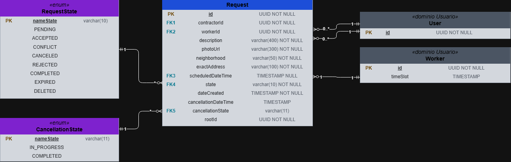
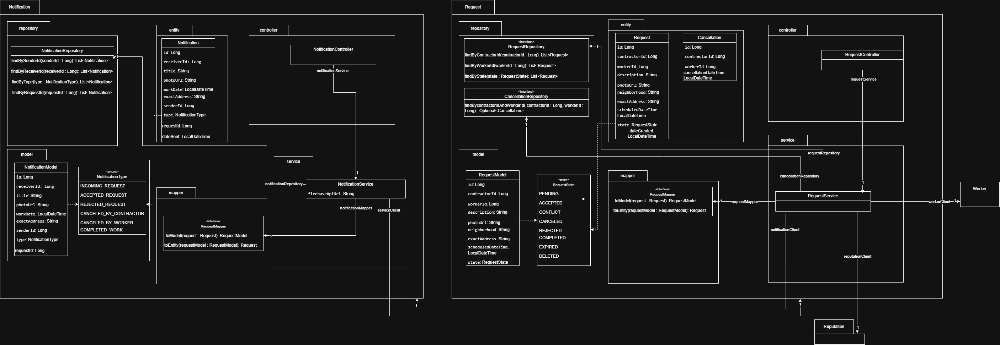
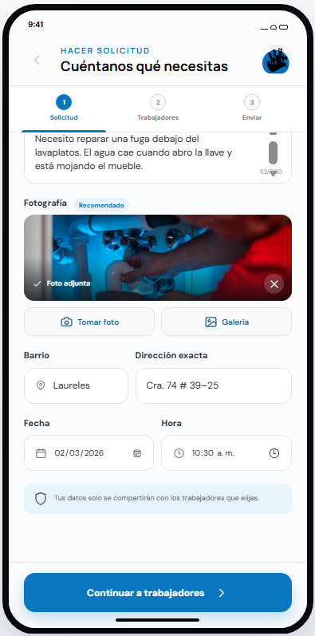
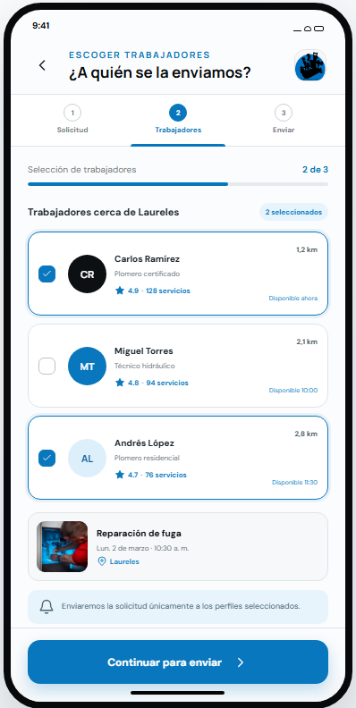
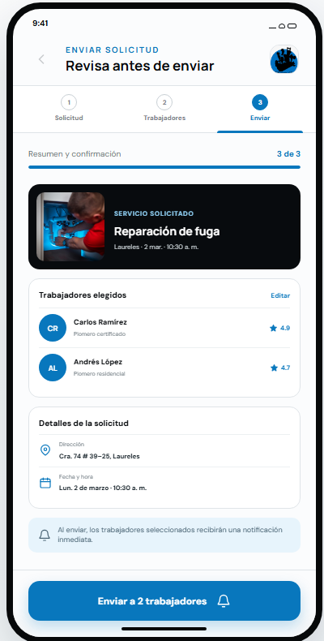
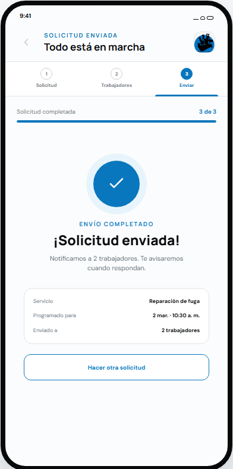
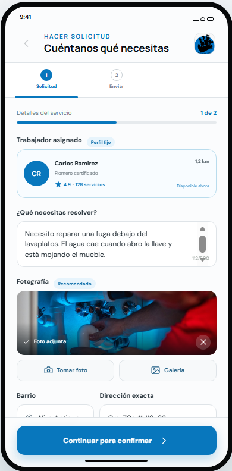
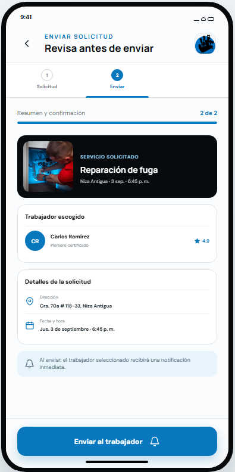
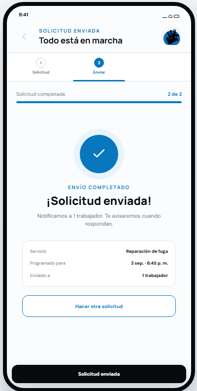

# oficioya-service

## Requerimientos Funcionales - Dominio Service

| Campo | Descripción|
|---|---|
| **Proyecto** | OficioYa |
| **Squad** | 4 |
| **Dominio** | Service |
| **Product Owner** | Juan Jose Rivera |
| **Analista Funcional** | Santiago Gomez |
| **Lider Técnico** | Juan Esteban Laverde |
| **Equipo de Desarrollo** | Brian Fierro, Diego Mesa |

## Diagrama entidad-relación

## Diagrama de clases

## Cómo ejecutar

1. Levantar el back con perfil `dev` en `http://localhost:8080`.
2. El front se ejecuta en `http://localhost:5173` y se conecta por proxy a `/api`.
3. Repositorio del front: https://github.com/juanjorivlo/DOSW_Lab9_Front_FLRGM

## Endpoints principales (prefijo `/api/v1`)

| Método | Endpoint | Descripción |
|---|---|---|
| POST | `/auth/login` | Login (devuelve JWT, opcional) |
| GET | `/usuarios/me` | Perfil del usuario autenticado |
| GET | `/trabajadores` | Listar trabajadores |
| GET | `/trabajadores/{id}` | Detalle de trabajador |
| GET | `/solicitudes` | Listar solicitudes del usuario |
| PUT | `/solicitudes` | Crear solicitud (CONTRATANTE) |
| PATCH | `/solicitudes/{id}/aceptar` | Aceptar (TRABAJADOR) |
| PATCH | `/solicitudes/{id}/rechazar` | Rechazar (TRABAJADOR) |
| PATCH | `/solicitudes/{id}/cancelar` | Cancelar (CONTRATANTE/TRABAJADOR) |
| PATCH | `/solicitudes/{id}/complete` | Completar (TRABAJADOR) |
| PATCH | `/solicitudes/{id}/accept-conflict` | Resolver conflicto (CONTRATANTE) |
| DELETE | `/solicitudes/{id}` | Eliminar (CONTRATANTE) |
| GET | `/services/workers/{id}/stats` | Estadísticas del trabajador |
| GET | `/services/reports?from=&to=` | Reporte de solicitudes por período |

## Integración con otros microservicios

- **Notification:** `HttpNotificationService` envía eventos (creación, aceptación, cancelación, completado) a `POST /api/v1/notification`.
- **Reputation:** penalización de -0.5 al cancelar con menos de 24h (placeholder).
- **Worker:** reserva/liberación de franja horaria (placeholder).
- **Search:** contrato OpenAPI disponible en `/v3/api-docs`.
- **User/Identity:** validación de existencia de usuario por UUID.

## Pruebas

- Ejecutar: `mvn clean verify`
- Cobertura mínima: 80% (JaCoCo)
- Perfil de prueba: H2 en memoria (`application-test.properties`)

## Mock Up

### Link
[Link del figma](https://www.figma.com/make/wy8eVjfR1SbrWb3wUqMIkM/Sistema-de-calificaci%C3%B3n-5-estrellas?t=FlzxIc07XaISpXqc-20&fullscreen=1)

### Fotos

